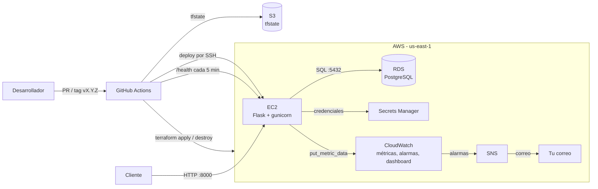

# to-do-list-api

API para gestionar tareas pendientes. Corre en una EC2 y guarda las tareas en RDS (PostgreSQL). Toda la infraestructura se crea con Terraform desde GitHub Actions, cada cambio pasa por CI/CD y la app reporta métricas a CloudWatch.

## Arquitectura



- La EC2 usa el rol `LabRole` (vía `LabInstanceProfile`) para leer el secreto de RDS y publicar métricas. La app nunca tiene la contraseña escrita en el código.
- RDS no es pública: su Security Group solo acepta conexiones desde el Security Group de la EC2.
- El tfstate vive en el bucket `todo-api-tfstate-<cuenta>`, que el workflow crea si no existe. Nunca se sube al repositorio.

## Endpoints

| Endpoint | Descripción |
|---|---|
| `GET /tasks` | Lista las tareas |
| `POST /tasks` | Crea una tarea. Body: `{"title": "texto", "done": false}` |
| `GET /version` | Versión desplegada, leída de la variable de ambiente `APP_VERSION` |
| `GET /health` | Estado de la conexión a la base (`OK`/`FAIL`), versión y timestamp del servidor |

```bash
curl -X POST http://<ip-de-tu-ec2>:8000/tasks \
  -H "Content-Type: application/json" \
  -d '{"title": "estudiar para el examen de desarrollo en la nube", "done": false}'

curl http://<ip-de-tu-ec2>:8000/tasks
curl http://<ip-de-tu-ec2>:8000/health
```

## Estructura

```
├── app.py                  # Rutas de la API
├── db.py                   # Acceso a RDS; cuenta cada error en la métrica DatabaseErrors
├── metrics.py              # Publica métricas propias en CloudWatch (put_metric_data)
├── requirements.txt        # Dependencias de la app
├── requirements-dev.txt    # + pytest
├── tests/test_app.py       # Pruebas unitarias (no tocan AWS)
├── scripts/deploy.sh       # Corre en la EC2: instala un release y reinicia la app
├── terraform/              # EC2, Security Groups, Key Pair, RDS, Secrets Manager, SNS, alarmas, dashboard
├── alerting/
│   ├── alarms.json               # Definición de las 3 alarmas (Terraform las lee)
│   └── cloudwatch-dashboard.json # Dashboard con las 3 métricas (Terraform lo lee)
└── .github/
    ├── actions/terraform-setup/  # Credenciales de AWS + bucket del tfstate + terraform init
    └── workflows/
        ├── infra-apply.yml       # Provisionar infraestructura (manual)
        ├── infra-destroy.yml     # Destruir infraestructura (manual)
        ├── ci.yml                # Pruebas en cada PR
        ├── release.yml           # Tag v#.#.# → release con zip
        ├── deploy.yml            # Release publicado → deploy en la EC2
        └── health-check.yml      # Revisa /health cada 5 minutos
```

## Correr las pruebas en local

```bash
python -m venv .venv
source .venv/bin/activate        # Windows: .venv\Scripts\activate
pip install -r requirements-dev.txt
pytest -v
```

Las pruebas sustituyen la base de datos y CloudWatch por objetos falsos, así que no necesitan credenciales de AWS.

## Configuración inicial (una sola vez)

En **Settings → Secrets and variables → Actions → Repository secrets** del repositorio:

| Secret | Valor | ¿Cuándo se actualiza? |
|---|---|---|
| `AWS_ACCESS_KEY_ID` | De Learner Lab: **AWS Details → AWS CLI: Show** | Cada sandbox nuevo |
| `AWS_SECRET_ACCESS_KEY` | Ídem | Cada sandbox nuevo |
| `AWS_SESSION_TOKEN` | Ídem | Cada sandbox nuevo |
| `GH_PAT` | Fine-grained token de este repo con permisos *Contents* y *Secrets* en lectura y escritura | Cuando expire |
| `ALERT_EMAIL` | Correo que recibe las alarmas | Nunca |

`EC2_HOST` y `EC2_SSH_KEY` los crea y borra el workflow de infraestructura; no se crean a mano.

El `GH_PAT` es necesario porque el `GITHUB_TOKEN` por defecto no puede escribir secrets, y un release creado con él no dispara el workflow de deploy.

Para que solo se integren cambios con pruebas en verde, `main` tiene un ruleset (**Settings → Rules → Rulesets**) que exige PR y el check **Pruebas unitarias**.

## Crear la infraestructura

1. Actualiza los 3 secrets de AWS con las credenciales del sandbox actual.
2. **Actions → Infra - Apply → Run workflow**. Tarda unos 10 minutos (RDS es lo más lento).
3. Al terminar, el resumen de la ejecución muestra la respuesta de `/health` y la liga al dashboard.
4. La primera vez que se crea el tópico de SNS llega un correo **AWS Notification - Subscription Confirmation**. Hay que hacer clic en *Confirm subscription* para recibir las alarmas.

La instancia arranca sola con `user_data`: clona el repositorio, instala dependencias y levanta la app con systemd. No se usa SSH ni scp.

## Destruir la infraestructura

**Actions → Infra - Destroy → Run workflow**, escribiendo `destroy` en el campo de confirmación. Borra todos los recursos y los secrets `EC2_HOST` y `EC2_SSH_KEY`. El bucket del tfstate se conserva para la siguiente ejecución.

## Flujo de un cambio (CI/CD)

1. **CI:** abre un PR hacia `main`. El workflow *CI* corre las pruebas y el merge se bloquea si fallan.
2. **Release:** después del merge, crea y empuja una etiqueta:
   ```bash
   git switch main && git pull
   git tag v1.2.0
   git push origin v1.2.0
   ```
   El workflow *Release* vuelve a correr las pruebas y publica un release con `to-do-list-api-v1.2.0.zip`.
3. **Deploy:** al publicarse el release, el workflow *Deploy* descarga el zip en la EC2, reinicia la app y confirma con `GET /version` que quedó corriendo `v1.2.0`.

Para volver a desplegar una versión, por ejemplo después de recrear la infraestructura, usa **Actions → Deploy → Run workflow** con el tag.

## Observabilidad

### Métricas

| Métrica | Tipo | Qué mide |
|---|---|---|
| `AWS/EC2 CPUUtilization` | Nativa de AWS | Uso de CPU de la instancia que corre la API |
| `TodoApi DatabaseErrors` | Propia (`put_metric_data`) | Cada vez que leer o escribir en RDS falla |
| `TodoApi TasksCreated` | Propia (`put_metric_data`) | Cada tarea creada con éxito |

`TasksCreated` mide el uso real de la aplicación: cuántas tareas se están registrando. Sirve para ver la actividad normal y detectar comportamientos anómalos, como un cliente que reintenta en bucle o alguien que llena la base con spam.

### Alarmas

Las 3 alarmas notifican al tópico de SNS `todo-api-alerts`, tanto al dispararse como al recuperarse.

| Alarma | Condición | Por qué | Acción esperada |
|---|---|---|---|
| `todo-api-ec2-cpu-alta` | Promedio > 80% en 3 periodos de 5 min | Una t3.micro es *burstable*; 15 minutos arriba de 80% consumen sus créditos y la vuelven lenta. Un pico corto no alarma. | Revisar en el dashboard si coincide con más tareas creadas (carga real) o no (proceso atorado). Subir el tamaño de la instancia o reiniciar la app. |
| `todo-api-rds-errores` | Suma ≥ 1 en 1 min | Con una base sana el valor normal es 0, así que cualquier error es significativo y conviene saberlo en cuanto pase. | Revisar `/health` y el estado de la instancia en RDS (detenida, sin conexiones, credenciales). Encenderla o corregir el Security Group o el secreto. |
| `todo-api-tareas-creadas-pico` | Suma > 20 en 5 min | Para una lista de pendientes personal, más de 20 tareas en 5 minutos no es uso normal. | Revisar qué cliente las está creando, limpiar duplicados y, si es abuso, limitar o bloquear el origen. |

### Probar la alarma de errores de RDS

```bash
aws rds stop-db-instance --db-instance-identifier todo-api-db   # tarda unos minutos en detenerse
curl http://<ip-de-tu-ec2>:8000/health                          # {"database": "FAIL", ...}
curl http://<ip-de-tu-ec2>:8000/tasks                           # 503
aws rds start-db-instance --db-instance-identifier todo-api-db
```

Cada petición fallida suma 1 a `DatabaseErrors`; en uno o dos minutos la alarma pasa a *In alarm* y llega el correo. El workflow *Health check* también falla mientras la base está apagada.

### Dashboard

El dashboard `todo-api` muestra las 3 métricas con una línea en el umbral de cada alarma. La liga aparece en el resumen de *Infra - Apply* y en `terraform output dashboard_url`.

## Terraform desde tu máquina (opcional)

El estado vive en S3, así que hay que indicar el bucket al inicializar:

```bash
cd terraform
terraform init -backend-config="bucket=todo-api-tfstate-<id-de-cuenta>"
terraform plan
```
